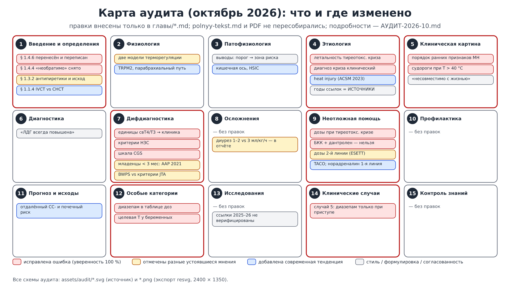
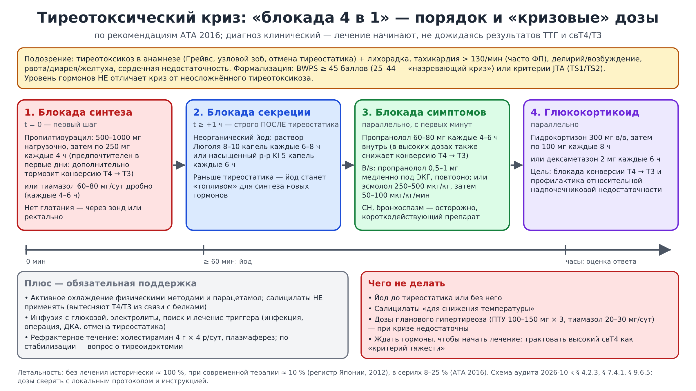
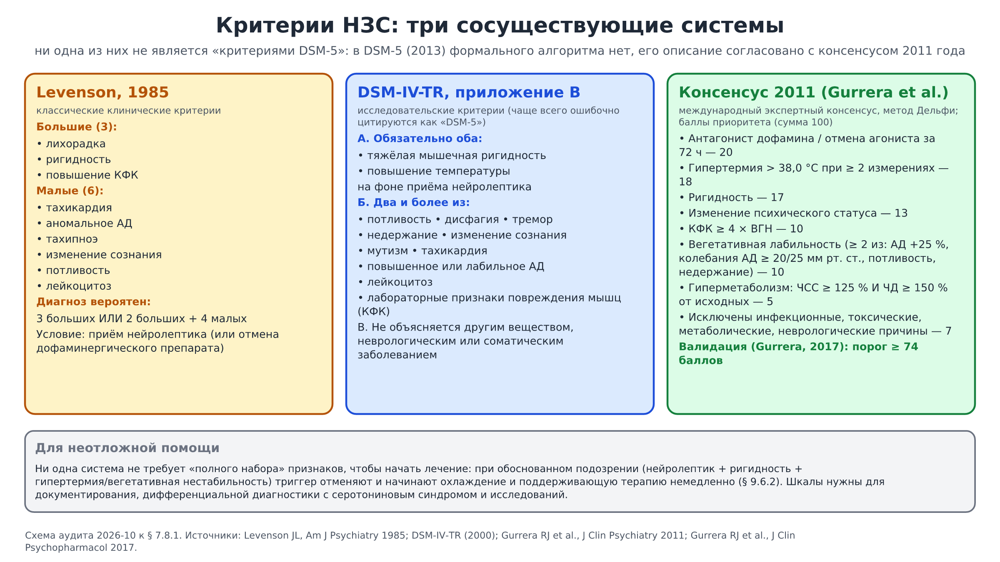
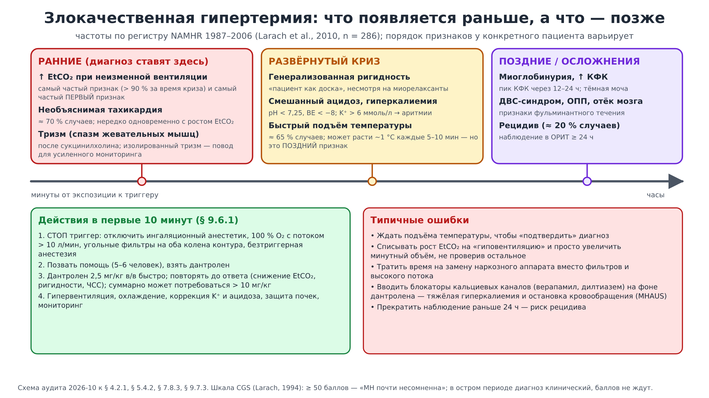
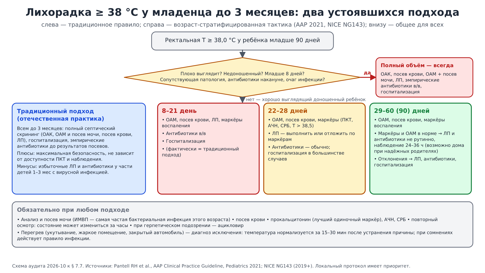
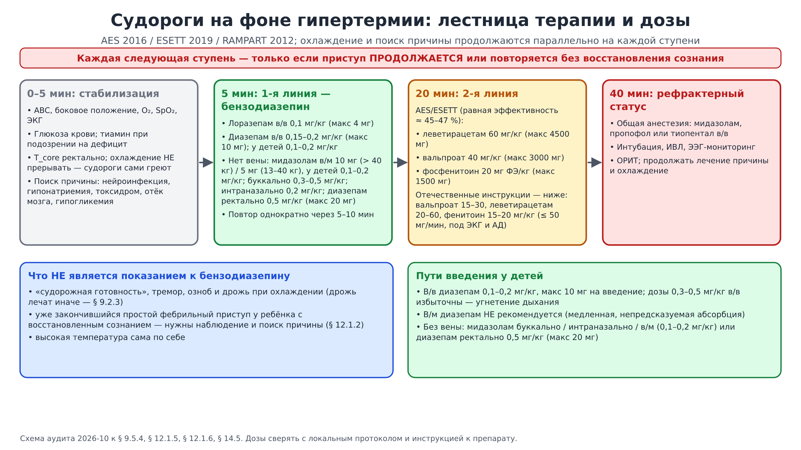
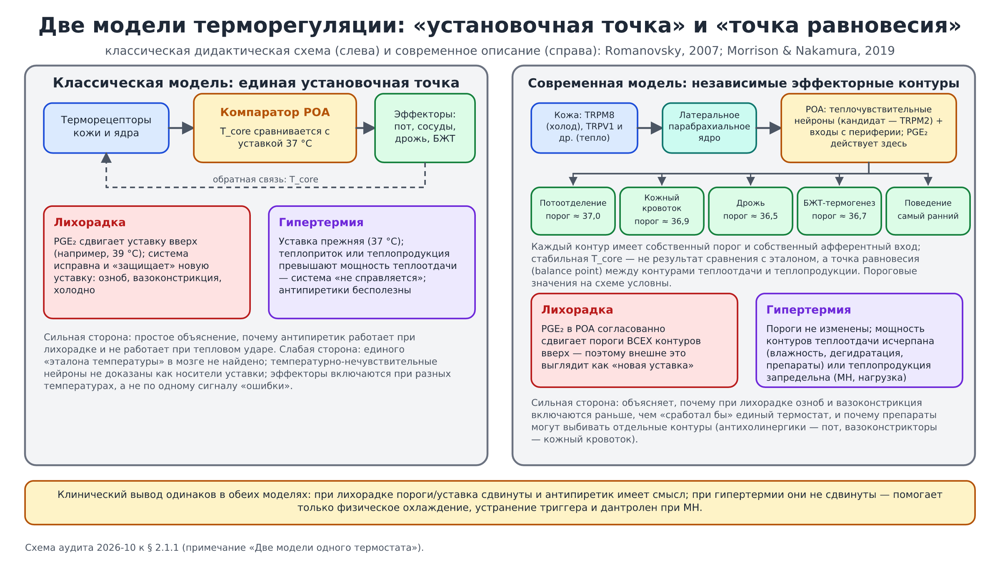
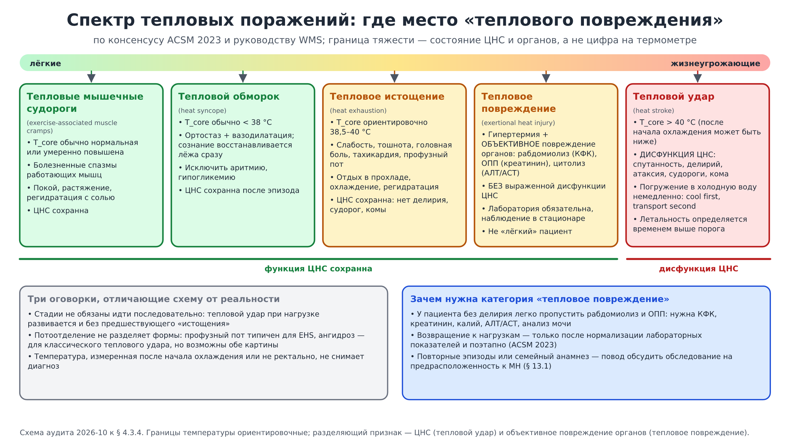

# Содержательный аудит монографии — октябрь 2026

Глубокая проверка всех 15 глав пособия «Гипертермический синдром» по состоянию
на 14 октября 2026 года. Документ фиксирует, **что именно изменено** в
`главы/*.md`, **что намеренно не менялось** (разные устоявшиеся мнения, не
проверяемые без доступа к базам данных утверждения) и какие **современные
тенденции** добавлены. Пояснительные схемы выполнены в SVG и экспортированы в
PNG (`assets/audit/`).

*Схема 0. Карта аудита: где исправлены ошибки (красная рамка), где отмечены
разные мнения, где добавлены современные положения.*

## 1. Как проводился аудит и каковы его границы

- **Объём.** Прочитаны полностью главы 1–15 (≈ 600 КБ текста), файлы
  `ИСТОЧНИКИ.md`, `СЛАЙДЫ.md`, `ИЛЛЮСТРАЦИИ.md`, `README.md`, `CLAUDE.md`,
  скрипты проверки и сборки.
- **Правило правки.** Текст менялся только там, где ошибка или внутреннее
  противоречие установлены с полной уверенностью (неверные дозы, перепутанные
  цифры, неверная атрибуция критериев, противоречие соседнему разделу того же
  пособия). Всё остальное — положения, по которым есть несколько устоявшихся
  школ, или факты, которые без доступа к первоисточнику нельзя перепроверить, —
  **не правилось**, а отмечено в тексте примечанием или перечислено ниже.
- **Эталон.** Действующие руководства и консенсусы: ATA 2016 (тиреотоксический
  криз), AES 2016 / ESETT 2019 / RAMPART 2012 (судороги и эпилептический
  статус), AAP 2021 и NICE NG143 (лихорадка у младенцев), ACSM 2023 и WMS
  (тепловые поражения при нагрузке), NATA 2015 (охлаждение на месте), MHAUS и
  EMHG 2024 (злокачественная гипертермия), международный консенсус 2011 года по
  критериям НЗС, Surviving Sepsis Campaign 2021 (вазопрессоры), современные
  обзоры патофизиологии (Epstein & Yanovich 2019; Bouchama 2022; Iba 2022;
  Morrison & Nakamura 2019).
- **Ограничение.** Аудит выполнен в изолированной среде без доступа к PubMed,
  сайтам обществ и DOI-резолверу. Поэтому публикации 2025–2026 годов, на которые
  ссылается текст (ERC 2025, руководство SCCM 2025 по тепловому удару,
  исследование дантролена при НЗС 2026 года, препринт о CACNA2D4), **повторно
  не верифицировались**: они сохранены как есть с прежними оговорками, а их
  проверка вынесена в раздел 6. Библиографические данные новых источников в
  `ИСТОЧНИКИ.md` приведены по памяти авторов аудита и помечены как требующие
  сверки перед цитированием в протоколах.
- **Регламент репозитория соблюдён.** Правились только `главы/*.md` и
  вспомогательные файлы; `polnyy-tekst.md` и PDF **не пересобирались** (по
  `CLAUDE.md` это делается отдельным явным решением владельца). Структурный
  аудит `python3 scripts/audit_markdown.py` проходит: единственное сообщение —
  ожидаемая рассинхронизация `polnyy-tekst.md`.

## 2. Сводка

| Категория | Количество | Где |
|---|:--:|---|
| Исправленные ошибки и внутренние противоречия (уверенность 100 %) | 17 | главы 1, 4, 5, 6, 7, 9, 12, 14 |
| Отмеченные разные устоявшиеся мнения (текст не «исправлялся», добавлено примечание) | 8 | главы 1, 2, 7, 9 (+ раздел 4 ниже) |
| Добавленные современные положения | 9 | главы 1, 2, 3, 4, 9, 11 |
| Положения, оставленные без изменений, но требующие проверки владельцем | 12 | раздел 6 |
| Схемы SVG → PNG | 8 | `assets/audit/` |

## 3. Исправленные ошибки (было → стало)

Нумерация разделов глав сохранена; скрипт проверки структуры проходит.

### 3.1. Дозы и клинические цифры

| № | Место | Было | Стало | Основание |
|---|---|---|---|---|
| 1 | § 9.6.5, тиреотоксический криз | ПТУ 100–150 мг 3 раза в сутки; пропранолол 40–80 мг 3 раза в сутки; йодид «50–100 мг 3 раза в сутки» | ПТУ 500–1000 мг нагрузочно, затем 250 мг каждые 4 ч (или тиамазол 60–80 мг/сут дробно); пропранолол 60–80 мг каждые 4–6 ч, в/в 0,5–1 мг медленно или эсмолол; раствор Люголя 8–10 капель каждые 6–8 ч / SSKI 5 капель каждые 6 ч не ранее чем через 1 ч; гидрокортизон 300 → 100 мг каждые 8 ч или дексаметазон 2 мг каждые 6 ч; без салицилатов; холестирамин/плазмаферез при рефрактерности | Прежние дозы — дозы планового лечения гипертиреоза, при кризе они недостаточны (ATA 2016, табл. «Drugs used in thyroid storm») |
| 2 | § 4.2.3, летальность криза | «10–20 % без лечения, менее 5 % при адекватной терапии» | без лечения исторически ≈ 100 %; при современной терапии ≈ 10 % (регистр Японии, 2012), в сериях 8–25 % (ATA 2016) | цифры были инвертированы |
| 3 | § 7.4.1, лаборатория криза | «свТ4 > 20 мкг/дл, Т3 > 200 пг/мл резко повышены» | ТТГ подавлен, свТ4/Т3 повышены, но их уровень не отличает криз от неосложнённого тиреотоксикоза; диагноз клинический | единицы были некорректны (свТ4 измеряют в нг/дл или пмоль/л), а главное — криз не определяется уровнем гормонов; то же отражено в § 4.2.3 |
| 4 | § 12.1.5, таблица доз | диазепам «в/в / в/м 0,3–0,5 мг/кг (в/в 0,1–0,2)» — противоречило § 12.1.6 того же раздела | диазепам в/в 0,1–0,2 мг/кг (макс 10 мг, однократный повтор), ректально 0,5 мг/кг (макс 20 мг), в/м не рекомендуется; добавлена строка мидазолама (буккально/интраназально/в/м) | AES 2016; собственный § 12.1.6, где 0,3–0,5 мг/кг названы избыточными |
| 5 | § 14.5, случай 5, шаг 3 | «при сохраняющейся судорожной готовности — диазепам 0,3 мг/кг» | бензодиазепин только при повторном/продолжающемся приступе: диазепам 0,1–0,2 мг/кг в/в (макс 10 мг) или мидазолам без венозного доступа; «готовность» — не показание | прямое противоречие § 12.1.6 и § 9.1 |
| 6 | § 12.3.3, беременные | «целевая температура та же — 38,0–38,5 °C» | точка остановки активного охлаждения та же, что в § 9.2.3: 38,6–39,0 °C при тепловом ударе, < 38,5 °C при MH | противоречие § 9.2.3 и § 15 |
| 7 | § 9.8, вазопрессоры | дофамин 2–20 мкг/кг/мин как равноправный препарат | норадреналин — первая линия; адреналин/вазопрессин — добавление; дофамин — резерв (аритмогенность, особенно при гиперкалиемии) | Surviving Sepsis Campaign 2021 |

### 3.2. Злокачественная гипертермия

| № | Место | Было | Стало | Основание |
|---|---|---|---|---|
| 8 | § 5.4.2 против § 4.2.1 | § 5.4.2: «необъяснимая тахикардия — первый и самый частый признак»; § 4.2.1: «самый ранний признак — рост EtCO₂» | гармонизировано: гиперкапния — самый частый (> 90 %) и, как правило, самый ранний признак; тахикардия — второй (≈ 70 %); порядок варьирует, важно сочетание | регистр NAMHR, Larach et al., 2010 |
| 9 | § 7.8.3, шкала CGS | «шкала MHAUS, 12 признаков, рост EtCO₂ — наиболее весомый признак» | шкала Larach et al., 1994 (поддерживается MHAUS): шесть групп процессов, внутри группы учитывается максимальный признак; по 15 баллов дают ригидность, тризм, КФК, EtCO₂/PaCO₂, быстрый подъём температуры и семейный анамнез; ≥ 50 — D6 «почти несомненна» | первоисточник шкалы |
| 10 | § 9.6.1 и § 9.7.3 | отсутствовало | добавлено предупреждение MHAUS: блокаторы кальциевых каналов противопоказаны на фоне дантролена (гиперкалиемия, остановка кровообращения) | MHAUS «Managing a crisis» |
| 11 | § 1.1.4, история теста | «первое подробное описание кофеинового теста… 1977» | добавлены Kalow & Britt (Lancet, 1970) и Ellis (1971), два протокола — IVCT (EMHG, 1984) и CHCT (NAMHG, 1989) | хронология и наличие двух протоколов — установленный факт |

### 3.3. Критерии и определения

| № | Место | Было | Стало | Основание |
|---|---|---|---|---|
| 12 | § 7.8.1, критерии НЗС | «DSM-5: гипертермия > 38,5 °C + ригидность + три признака…»; Levenson — «большие (все три)», малые без потливости | три реально существующие системы: Levenson 1985 (3 больших или 2 больших + 4 малых), исследовательские критерии DSM-IV-TR (ошибочно цитируемые как DSM-5), международный консенсус 2011 с баллами и порогом ≥ 74 (валидация 2017) | первоисточники критериев |
| 13 | § 5.6, дети до года | «при T > 40 °C любые судороги следует расценивать как признак ГС» | температура сама по себе тип судорог не определяет (как и сказано в § 8.1.1, § 12.1.2); перечислены красные флаги, требующие исключения нейроинфекции; в контексте перегрева — тепловой удар до доказательства обратного | внутреннее противоречие пособия |
| 14 | § 1.4.6 | раздел физически стоял после § 1.5.2, дублировал § 1.4.5 и утверждал, что «> 40,5 °C и задержка > 30 мин — независимые факторы фатального исхода (ERC 2025)» | перенесён на своё место (после § 1.4.5), переписан: гипотензия — маркёр тяжести; 40,5 °C — определяющий ориентир, а не порог необратимости; «30 минут» — цель процесса из спортивной медицины (NATA/ACSM), а не биологический рубеж | противоречие README, § 1.2.1, § 3.3, § 9.2.1; атрибуция ERC не подтверждается текстом § 1.4.5 и `ИСТОЧНИКИ.md` |
| 15 | § 4.2.1 | «Dawson & Buckley, 2015», «Arens et al., 2017» | 2016 и 2018 — как в `ИСТОЧНИКИ.md` (годы выпуска журналов) | согласованность с библиографией |

### 3.4. Формулировки, противоречившие заявленной позиции пособия

README обещает избегать формулировок «выше X °C повреждение необратимо», но
они оставались в тексте. Исправлены с сохранением смысла «зона очень высокого
риска»:

| № | Место | Было | Стало |
|---|---|---|---|
| 16 | § 1.4.4; выводы гл. 3; § 5.1.1; § 6.3.2 (ЛДГ) | «выше 41–42 °C каскад становится необратимым»; «при T > 41–42 °C… клетки гибнут»; «> 42–43 °C часто несовместимо с жизнью»; «ЛДГ всегда повышена» | «риск растёт с высотой и длительностью… универсальной границы нет»; «зона крайне высокого риска… описаны случаи выживания… не основание для отказа от лечения»; «ЛДГ, как правило, повышена при тяжёлых формах» |
| 17 | § 1.3.2 | «пациенты с умеренной лихорадкой нередко выздоравливают быстрее тех, у кого её агрессивно подавляли… это подтверждает защитную роль» | данные неоднородны: РКИ HEAT (2015) и метаанализы не показали влияния контроля температуры на выживаемость; аргумент против рутинного «сбивания» — отсутствие доказанной пользы, а не доказанный вред |

## 4. Разные устоявшиеся мнения — отмечены, но не «исправлены»

1. **Установочная точка против точки равновесия (§ 2.1.1).** Классическая
   модель единого set-point остаётся дидактическим стандартом; современная
   нейрофизиология описывает независимые термоэффекторные контуры и balance
   point (Romanovsky 2007; Morrison & Nakamura 2019). Обе модели дают один
   клинический вывод; в главу добавлено примечание и схема 6. Попутно
   уточнено, что молекулярная основа центральной термочувствительности не
   установлена (ведущий кандидат — TRPM2), а кожные сигналы к POA идут через
   латеральное парабрахиальное ядро.
2. **Тактика при лихорадке у младенцев до 3 месяцев (§ 7.7).** Традиционное
   правило «всем — полный септический скрининг с ЛП и антибиотики» против
   возраст-стратифицированной тактики AAP 2021 / NICE NG143. Оба подхода
   описаны, локальный протокол имеет приоритет; схема 4.
3. **Шкала BWPS против критериев JTA при тиреотоксическом кризе (§ 7.4.1).**
   BWPS чувствительнее, JTA специфичнее; ATA 2016 допускает оба инструмента.
4. **Дозы противосудорожных препаратов второй линии (§ 9.5.4).** AES 2016 /
   ESETT используют леветирацетам 60 мг/кг, вальпроат 40 мг/кг, фосфенитоин
   20 мг ФЭ/кг; отечественные инструкции — заметно ниже. Приведены обе шкалы;
   схема 5.
5. **Ципрогептадин при серотониновом синдроме (§ 9.6.3).** Режим Boyer &
   Shannon (12 мг → 2 мг каждые 2 ч) против более простых режимов австралийской
   школы (Isbister); в тексте уже стояла оговорка о слабой доказательной базе —
   оставлено без изменений.
6. **Целевой диурез при рабдомиолизе (§ 8.3.2).** В пособии — 1–2 мл/кг/ч; ряд
   источников (Bosch et al., NEJM 2009) ориентируют на ≈ 3 мл/кг/ч при
   отсутствии перегрузки. Оставлено, так как текст подчёркивает титрование по
   перфузии и риску перегрузки, что соответствует современным консенсусам.
7. **Деление педиатрической лихорадки на «розовую» и «белую» со спазмолитиком
   (§ 12.1.6, § 14.5).** Национальная практика против NICE/AAP; в тексте уже
   разграничено, при аудите только убрано противоречие по диазепаму.
8. **Вклад излучения в теплоотдачу в покое (§ 1.2.2 — 40–45 %, § 2.3.1 —
   до 60 %).** Диапазоны источников действительно расходятся; текст § 2.3.1 уже
   содержит оговорку о зависимости от среды — не менялось.

## 5. Современные тенденции, добавленные в текст

| Место | Что добавлено |
|---|---|
| § 1.4.6 | корректное прочтение «30 минут» (NATA/ACSM: охлаждение на месте, выживаемость ≈ 100 % при соблюдении) и данных ВОЗ о тепловых волнах |
| § 2.1.1 | примечание о двух моделях терморегуляции, TRPM2, парабрахиальном пути |
| § 3.3.2 | «кишечная ось» теплового удара: эндотоксемия как второй источник воспаления (Epstein & Yanovich 2019; Bouchama 2022) |
| § 3.3.5 | понятие heat stroke-induced coagulopathy (HSIC, Iba 2022) и динамическая оценка по шкале ISTH |
| § 4.3.4 | категория **тепловое повреждение** (exertional heat injury) по ACSM 2023 / WMS; схема 7 |
| § 9.2.1 | метод TACO (брезентовое погружение) как полевой эквивалент ванны |
| § 9.5.4 | мидазолам в/м по RAMPART; ESETT |
| § 9.8 | норадреналин как вазопрессор первой линии (SSC 2021) |
| § 11.5.3 | отдалённые последствия теплового удара: избыточная смертность и сердечно-сосудистый/почечный риск (Wallace 2007; Argaud 2007; тайваньская когорта 2019) → плановое наблюдение после выписки |

Не добавлены в текст, но заслуживают внимания при следующем пересмотре:
руководство SCCM 2025 по тепловому удару (уже цитируется в § 9.6; при наличии
доступа стоит сверить формулировку рекомендаций по погружению в холодную воду
при классическом тепловом ударе у пожилых); консенсус EMHG о показаниях к
обследованию на предрасположенность к MH после теплового удара при нагрузке и
рабдомиолиза; ривастигмин как альтернатива физостигмину при его дефиците;
число описанных вариантов RYR1 (в § 13.1.1 «более 400» — заниженная, но не
ложная оценка).

## 6. Не исправлялось — требует проверки владельцем по первоисточникам

1. **Все ссылки 2025–2026 годов** (ERC 2025; SCCM 2025, DOI
   10.1097/CCM.0000000000006551; Suekane et al. 2026, DOI 10.1111/acps.70073;
   препринт Charpentier et al. 2026; обзоры Frontiers/Shock 2025) — недоступны
   для проверки из среды аудита. Формулировки в тексте сохранены вместе с
   оговорками о дизайне исследований.
2. **«10 % против 33 %» при тепловом ударе с гипотензией (§ 1.4.5, § 11.1.6).**
   Происхождение цифр по-прежнему не подтверждено официальной публикацией ERC
   (см. примечание в `ИСТОЧНИКИ.md`); в тексте они поданы как наблюдательный
   ориентир, что корректно.
3. **§ 1.1.3: «10 из 24 родственников» в семье Денборо.** В разных пересказах
   фигурируют 10 из 24 и 10 из 38 родственников, перенёсших анестезию; сверить
   с Denborough et al., Br J Anaesth 1962.
4. **§ 4.2.4: «T > 41 °C — маркёр тяжёлого течения малярии».** В действующих
   критериях ВОЗ тяжёлой малярии гиперпирексия отсутствует; оставлено как
   клиническое наблюдение, но формулировку стоит смягчить.
5. **§ 9.2.2: скорость внутрисосудистого охлаждения «0,5–1,5 °C/ч».** Цифра
   правдоподобна для систем управляемой температуры, но без ссылки.
6. **§ 2.2.3: частота дрожи «10–20 сокращений в секунду».** В литературе
   приводятся разные диапазоны (от 4–8 до 10–20 Гц в зависимости от метода
   регистрации); нужна ссылка.
7. **§ 9.6.1: интервал повторных доз дантролена «каждые 5–10 минут».** MHAUS и
   EMHG формулируют «повторять до ответа»; расхождение непринципиально, но
   стоит процитировать актуальный протокол дословно.
8. **§ 12.3.1: «лихорадка в I триместре — доказанный фактор риска дефектов
   нервной трубки».** Ассоциация наблюдательная (метаанализы Moretti 2005;
   Dreier 2014); слово «доказанный» желательно заменить на «установленный
   фактор риска по данным наблюдательных исследований».
9. **§ 7.8.2: критерии Hunter** содержат вставки «в ряде формулировок — или
   диарея» и «в части источников — > 38,5 °C»; оригинал (Dunkley et al., 2003)
   этих вариантов не содержит. Безопасно, но можно упростить.
10. **СЛАЙДЫ.md, слайд 02:** указано, что «окно 30 минут» в тексте снято, тогда
    как § 9.2.1 и § 1.4.6 сохраняют его как цель процесса. Формулировку
    расхождения уточнил (см. ниже), сами слайды не менялись.
11. **PDF монографии** после правок октября 2026 года устарел относительно
    глав; пересборка — отдельное решение владельца.
12. **`polnyy-tekst.md`** не пересобирался (по регламенту `CLAUDE.md`).

## 7. Схемы (SVG → PNG)

Все схемы построены вручную в SVG (исходники `assets/audit/*.svg`,
генераторы — `scripts/audit_schemes/`), экспортированы в PNG 2400 × 1350 через
`@resvg/resvg-js` со шрифтом DejaVu Sans; текст в SVG редактируем. В главы
вставлены только ссылки (растровые изображения в главах не допускаются по
регламенту); сами изображения — здесь и в `ИЛЛЮСТРАЦИИ.md`.

*Схема 1 (к § 4.2.3, § 7.4.1, § 9.6.5). «Блокада 4 в 1»: порядок шагов, интервал
≥ 1 ч до йода и «кризовые» дозы по ATA 2016; отдельный блок «чего не делать».*

*Схема 2 (к § 7.8.1). Три сосуществующие системы критериев нейролептического
злокачественного синдрома и их место в неотложной помощи.*

*Схема 3 (к § 4.2.1, § 5.4.2, § 7.8.3, § 9.7.3). Ранние, развёрнутые и поздние
признаки MH с частотами регистра NAMHR; действия первых 10 минут и типичные
ошибки, включая запрет блокаторов кальциевых каналов на фоне дантролена.*

*Схема 4 (к § 7.7). Традиционный и возраст-стратифицированный (AAP 2021, NICE
NG143) подходы к лихорадке у младенца; общие обязательные элементы.*

*Схема 5 (к § 9.5.4, § 12.1.5, § 12.1.6, § 14.5). Ступени терапии судорог при
гипертермии с дозами AES/ESETT и отечественными диапазонами; что не является
показанием к бензодиазепину.*

*Схема 6 (к § 2.1.1). Классическая модель установочной точки и современная
модель независимых термоэффекторных контуров; одинаковый клинический вывод.*

*Схема 7 (к § 4.3.4). Спектр тепловых поражений при нагрузке по ACSM 2023 с
категорией «тепловое повреждение» между истощением и ударом.*

## 8. Технические примечания

- `python3 scripts/audit_markdown.py` — проходит полностью (структура,
  нумерация, ссылки, Mermaid, размеры PNG, синхронность `polnyy-tekst.md`
  после пересборки `scripts/build_full_text.py`).
- Пересборка схем: `NODE_PATH=<каталог>/node_modules bash
  scripts/audit_schemes/build.sh` (требуются `python3`, `node`, пакет
  `@resvg/resvg-js`, шрифты DejaVu). Маркеры стрелок в SVG заданы как
  `orient="auto"`: растеризатор resvg игнорирует `auto-start-reverse`, из-за
  чего в первой версии PNG наконечники вертикальных стрелок (схемы 04, 06, 07)
  смотрели вбок; PNG перегенерированы.
- Итоговые документы собираются `python3 scripts/pdf/build_final_docs.py`
  (reportlab, Pillow, markdown-it-py; Mermaid-схемы глав растеризуются
  собственным рендером `scripts/pdf/mermaid_render.py` через resvg):
  `Гипертермический_синдром_итоговый_текст_2026-10.md`,
  `Гипертермический_синдром_Монография_2026-10.pdf` (все схемы),
  `Гипертермический_синдром_Схемы_2026-10.pdf` (только PNG-схемы аудита).
- Изменённые файлы: главы 01, 02, 03, 04, 05, 06, 07, 09, 11, 12, 14;
  `ИСТОЧНИКИ.md` (новый блок источников и ограничений), `ИЛЛЮСТРАЦИИ.md`
  (раздел со схемами аудита), `СЛАЙДЫ.md` (уточнение по слайду 02),
  `README.md` (ссылка на аудит и схемы); новые каталоги `assets/audit/`,
  `scripts/audit_schemes/`, `scripts/pdf/`.
